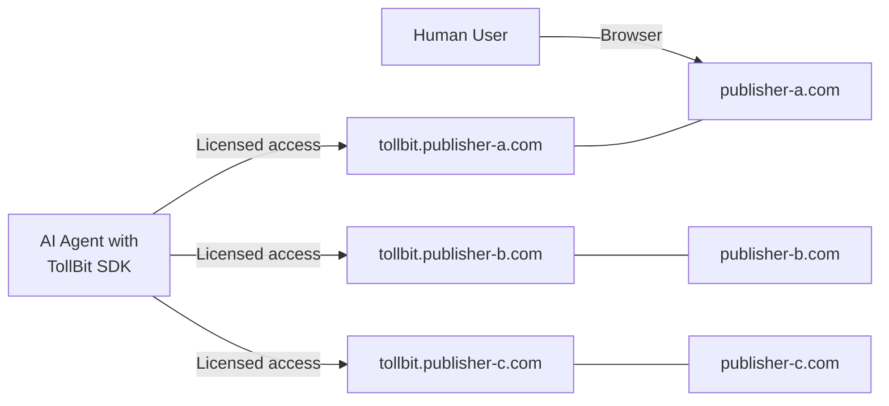

<p align="center">
  <a href="https://tollbit.com">
    <picture>
      <source media="(prefers-color-scheme: dark)" srcset="assets/tollbit-logo-dark.svg">
      
    </picture>
  </a>
</p>

<h3 align="center">Your complete web stack for the agentic internet</h3>

<p align="center">The official Python SDK for licensed AI access to content on the TollBit network.</p>

<br>

<p align="center">
  <a href="https://tollbit.com"></a>
  <a href="https://docs.tollbit.com"></a>
  <a href="https://pypi.org/project/tollbit-python-sdk/"></a>
</p>

# TollBit

TollBit is the web stack for the agentic internet. Publishers use TollBit to see which AI agents visit their sites, control what those agents can access, and set their terms for paid AI access. AI developers use TollBit to discover those terms and license content through one API, instead of negotiating one-off contracts or scraping.

## How TollBit Works

Publishers on the TollBit network give AI visitors their own way in: an Agent Site on a `tollbit` subdomain (for example `tollbit.example.com`), separate from human traffic. Each publisher chooses which licenses to offer and at what rates. AI systems discover those license terms programmatically before they access content, and every licensed request is logged.



## Licenses

TollBit licenses are built for retrieval-augmented generation (RAG), grounding, citation and display, not model training:

- **Standard Summarization License**: single-use access for summaries, citations or grounding
- **Standard Full Display License**: single-use display of the full article within an AI application
- **Custom licenses**: publisher-specific agreements, enforced alongside the standard licenses

Neither standard license permits training or generative reuse.

## For Publishers

TollBit gives publishers a free platform to understand AI traffic, separate it from human traffic, and enforce rules and rates for content access. Visit the [TollBit website](https://tollbit.com) to get started.

## For AI Developers

This SDK gives your agents licensed access to the TollBit network:

- Search and list the properties available on TollBit
- Check license rates before you access content
- Retrieve licensed content with your organization's API key
- Report your usage of licensed content

<!-- markdownlint-disable-next-line MD044 -->
# tollbit-python-sdk

TollBit's python SDK for interacting with TollBit's services. Pull this directly into your code to make requests; no need to write your own clients. The SDK supports both synchronous and asynchronous calls.

The SDK currently supports the following operations:

- [Indexing content to assist with knowledge graphs](#indexing-content)
- [Checking rates for paid content](#checking-rates)
- [Access paid content using your organization's API key](#accessing-paid-content)

## Installing

```shell
pip install tollbit-python-sdk
```

## Indexing Content

### Synchronous

```python
from tollbit import crawl_content
from tollbit import content_formats

client = crawl_content.create_client(
    secret_key="YOUR API KEY",
    user_agent="YOUR USER AGENT"
)

pages = client.list_content_catalog(
    url="https://pioneervalleygazette.com",
    page_size=5,
)

for page in pages.pages:
    print(f"URL: {page.page_url} Last Modified: {page.last_mod}")
    data = client.crawl_content(url=page.page_url)
    print(data.content.main)
```

To only list pages modified within a date range, pass `modified_from` and/or `modified_to` (a `date` or `datetime`):

```python
from datetime import date

pages = client.list_content_catalog(
    url="https://pioneervalleygazette.com",
    modified_from=date(2026, 9, 1),
)
```

For more examples please see [examples/crawl_content.py](examples/crawl_content.py)

### Asynchronous

```python
from tollbit import crawl_content
from tollbit import content_formats

client = crawl_content.create_async_client(
    secret_key="YOUR API KEY",
    user_agent="YOUR USER AGENT"
)

pages = await client.list_content_catalog(
    url="https://pioneervalleygazette.com",
    page_size=5,
)
```

For more examples please see [examples/crawl_content_async.py](examples/crawl_content_async.py)

## Listing Properties

Use the `crawl_client` to list the properties available on TollBit, along with their license types and rates.

```python
from tollbit import crawl_content

client = crawl_content.create_client(
    secret_key="YOUR API KEY",
    user_agent="YOUR USER AGENT"
)

properties = client.list_properties(ready_to_license=True)

for prop in properties.items:
    print(f"{prop.domain}: {[license.type for license in prop.licenses]}")

next_page = client.list_properties(ready_to_license=True, page_token=properties.next_token)
```

`list_properties` also accepts `page_size`, plus `added_from` and `added_to` to filter by when a property was added or had rates enabled. The async client exposes the same method.

For more examples please see [examples/list_properties.py](examples/list_properties.py)


## Checking Rates

You can use either the `use_client` or the `crawl_client` to check rates.

### Synchronous

```python
from tollbit import use_content
from tollbit import crawl_content

use = use_content.create_client(
    secret_key="YOUR API KEY", 
    user_agent="YOUR USER AGENT"
)
rate_info = use.get_rate(url="https://pioneervalleygazette.com/daydream")

crawl = crawl_content.create_client(
    secret_key="YOUR API KEY", 
    user_agent="YOUR USER AGENT"
)
rate_info = crawl.get_rate(url="https://pioneervalleygazette.com/daydream")
```

For more examples please see [examples/get_rates.py](examples/get_rates.py).

### Asynchronous

```python
from tollbit import use_content
from tollbit import crawl_content

use = use_content.create_async_client(
    secret_key="YOUR API KEY",
    user_agent="YOUR USER AGENT"
)
rate_info = await use.get_rate(url="https://pioneervalleygazette.com/daydream")

crawl = crawl_content.create_async_client(
    secret_key="YOUR API KEY",
    user_agent="YOUR USER AGENT"
)
rate_info = await crawl.get_rate(url="https://pioneervalleygazette.com/daydream")
```

For more examples please see [examples/get_rates_async.py](examples/get_rates_async.py)

### Custom licenses

Rates for custom licenses are only returned when you ask for them by license ID. Standard license rates are always returned.

```python
rate_info = use.get_rate(
    url="https://pioneervalleygazette.com/daydream",
    custom_license_ids=["YOUR CUSTOM LICENSE ID"],
)
```

### Batch

Use `get_rates` to check rates for several URLs in one request. It also accepts `custom_license_ids`, and each ID only applies to URLs on the property it belongs to.

```python
batch = use.get_rates(
    urls=[
        "https://pioneervalleygazette.com/daydream",
        "https://pioneervalleygazette.com/dragon",
    ],
    custom_license_ids=["YOUR CUSTOM LICENSE ID"],
)

for result in batch:
    print(result.url, [rate.license.cuid for rate in result.rates])
```

## Accessing sanctioned content

### Synchronous

```python
from tollbit import use_content
from tollbit import licenses
from tollbit import currencies

client = use_content.create_client(
    secret_key="YOUR API KEY", 
    user_agent="YOUR USER AGENT"
)

data = client.get_sanctioned_content(
    url="https://pioneervalleygazette.com/daydream",
    max_price_micros=11000000,
    currency=currencies.USD,
    license_type=licenses.types.ON_DEMAND_LICENSE
)

print(data.content.main)
```

For more examples please see [examples/get_content.py](examples/get_content.py).

### Asynchronous

```python
from tollbit import use_content
from tollbit import licenses
from tollbit import currencies

client = use_content.create_async_client(
    secret_key="YOUR API KEY", 
    user_agent="YOUR USER AGENT"
)

data = await client.get_sanctioned_content(
    url="https://pioneervalleygazette.com/daydream",
    max_price_micros=11000000,
    currency=currencies.USD,
    license_type=licenses.types.ON_DEMAND_LICENSE
)

print(data.content.main)
```

For more examples please see [examples/get_content_async.py](examples/get_content_async.py).

## Self reporting usage

### Synchronous

```python
from tollbit import self_reporting
from tollbit import licenses
from tollbit import use_content

reporting_client = self_reporting.create_client(
    secret_key="YOUR API KEY", 
    user_agent="YOUR USER AGENT"
)


# Create an array of your usages
usages = [self_reporting.usage(
        url="https://pioneervalleygazette.com/daydream",
        times_used=1,
        license_permissions=[licenses.permissions.LICENSE_PERMISSION_PARTIAL_USE],
        license_id="licenses-id-123",
        license_type=licenses.types.ON_DEMAND_LICENSE,
    )]

# Create an idempotent transaction block
transaction_block = reporting_client.create_transaction_block(usages)

# Report usages
result = reporting_client.report(transaction_block)
```

For more examples please see [examples/self_reporting.py](examples/self_reporting.py)

### Asynchronous

```python
from tollbit import self_reporting
from tollbit import licenses
from tollbit import use_content

reporting_client = self_reporting.create_async_client(
    secret_key="YOUR API KEY", 
    user_agent="YOUR USER AGENT"
)


# Create an array of your usages
usages = [self_reporting.usage(
        url="https://pioneervalleygazette.com/daydream",
        times_used=1,
        license_permissions=[licenses.permissions.LICENSE_PERMISSION_PARTIAL_USE],
        license_id="licenses-id-123",
        license_type=licenses.types.ON_DEMAND_LICENSE,
    )]

# Create an idempotent transaction block
transaction_block = reporting_client.create_transaction_block(usages)

# Report usages
result = await reporting_client.report(transaction_block)
```

For more examples please see [examples/self_reporting_async.py](examples/self_reporting_async.py)

## Search

### Synchronous

```python
from tollbit import search

search_client = search.create_client(
    secret_key="YOUR API KEY", 
    user_agent="YOUR USER AGENT"
)

results = client.search(q="DIY home projects for millenials")
```

To restrict results, pass `allowed_only=True` (properties your org is allowed to access) and/or `ready_to_license=True` (properties ready to license):

```python
results = client.search(q="DIY home projects for millenials", ready_to_license=True)
```

For more examples please see [examples/search.py](examples/search.py)

### Asynchronous

```python
from tollbit import search

search_client = search.create_async_client(
    secret_key="YOUR API KEY", 
    user_agent="YOUR USER AGENT"
)

results = await client.search(q="DIY home projects for millenials")
```

For more examples please see [examples/search_async.py](examples/search_async.py)

## Configuration

### `request_timeout`

All create client function can take the optional parameters `request_timeout` (float; defaults to 5.0) which sets a timeout for all network requests. Please be aware that some operations
use multiple network calls, and the timeout is set for each individual network request not for the client function call overall.

## Issues
We have disabled issues for the time being. Please reach out directly to TollBit.

## Contributions
We are not currently accepting contributions at this time. Thank you for your interest.

## Local setup
_For internal development teams only_

### Requirements

- [pyenv](https://formulae.brew.sh/formula/pyenv)
- poetry
    
    ```shell
    pipx install poetry
    ```

### Setup

```shell
make install
```

### Tests

Run standard tests
```shell
make tests
```

Run on all pythons
```shell
make matrix-tests
```

## Examples

Example code is available in [examples](./examples/)
